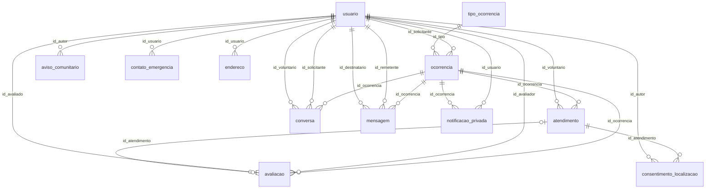

# Banco de dados atual — help_us2

Extraído do MySQL por SHOW CREATE TABLE e information_schema. Somente leitura; nenhum dado pessoal incluído.

## atendimento

```sql
CREATE TABLE `atendimento` (
  `id_atendimento` int NOT NULL AUTO_INCREMENT,
  `id_ocorrencia` int NOT NULL,
  `id_voluntario` int NOT NULL,
  `status` enum('aceito','recusado','finalizado','cancelado','desistiu') COLLATE utf8mb4_unicode_ci DEFAULT 'aceito',
  `aceito_em` datetime DEFAULT CURRENT_TIMESTAMP,
  `finalizado_em` datetime DEFAULT NULL,
  `recusado_em` datetime DEFAULT NULL,
  `recusa_desfeita_em` datetime DEFAULT NULL,
  `conclusao_solicitada_em` datetime DEFAULT NULL,
  PRIMARY KEY (`id_atendimento`),
  KEY `id_ocorrencia` (`id_ocorrencia`),
  KEY `id_voluntario` (`id_voluntario`),
  CONSTRAINT `atendimento_ibfk_1` FOREIGN KEY (`id_ocorrencia`) REFERENCES `ocorrencia` (`id_ocorrencia`) ON DELETE CASCADE ON UPDATE CASCADE,
  CONSTRAINT `atendimento_ibfk_2` FOREIGN KEY (`id_voluntario`) REFERENCES `usuario` (`id_usuario`) ON DELETE CASCADE ON UPDATE CASCADE
) ENGINE=InnoDB DEFAULT CHARSET=utf8mb4 COLLATE=utf8mb4_unicode_ci;
```

## avaliacao

```sql
CREATE TABLE `avaliacao` (
  `id_avaliacao` int NOT NULL AUTO_INCREMENT,
  `id_ocorrencia` int NOT NULL,
  `id_avaliador` int NOT NULL,
  `id_avaliado` int NOT NULL,
  `nota` int NOT NULL,
  `comentario` text COLLATE utf8mb4_unicode_ci,
  `criada_em` datetime DEFAULT CURRENT_TIMESTAMP,
  `id_atendimento` int DEFAULT NULL,
  PRIMARY KEY (`id_avaliacao`),
  UNIQUE KEY `uq_avaliacao_atendimento` (`id_atendimento`),
  KEY `id_ocorrencia` (`id_ocorrencia`),
  KEY `id_avaliador` (`id_avaliador`),
  KEY `id_avaliado` (`id_avaliado`),
  CONSTRAINT `avaliacao_ibfk_1` FOREIGN KEY (`id_ocorrencia`) REFERENCES `ocorrencia` (`id_ocorrencia`) ON DELETE CASCADE ON UPDATE CASCADE,
  CONSTRAINT `avaliacao_ibfk_2` FOREIGN KEY (`id_avaliador`) REFERENCES `usuario` (`id_usuario`) ON DELETE CASCADE ON UPDATE CASCADE,
  CONSTRAINT `avaliacao_ibfk_3` FOREIGN KEY (`id_avaliado`) REFERENCES `usuario` (`id_usuario`) ON DELETE CASCADE ON UPDATE CASCADE,
  CONSTRAINT `fk_avaliacao_atendimento` FOREIGN KEY (`id_atendimento`) REFERENCES `atendimento` (`id_atendimento`) ON DELETE CASCADE
) ENGINE=InnoDB DEFAULT CHARSET=utf8mb4 COLLATE=utf8mb4_unicode_ci;
```

## aviso_comunitario

```sql
CREATE TABLE `aviso_comunitario` (
  `id_aviso` int NOT NULL AUTO_INCREMENT,
  `id_autor` int NOT NULL,
  `titulo` varchar(120) COLLATE utf8mb4_unicode_ci NOT NULL,
  `descricao` text COLLATE utf8mb4_unicode_ci NOT NULL,
  `bairro` varchar(100) COLLATE utf8mb4_unicode_ci DEFAULT NULL,
  `latitude` decimal(10,8) DEFAULT NULL,
  `longitude` decimal(11,8) DEFAULT NULL,
  `ativo` tinyint(1) DEFAULT '1',
  `publicado_em` datetime DEFAULT CURRENT_TIMESTAMP,
  PRIMARY KEY (`id_aviso`),
  KEY `id_autor` (`id_autor`),
  CONSTRAINT `aviso_comunitario_ibfk_1` FOREIGN KEY (`id_autor`) REFERENCES `usuario` (`id_usuario`) ON DELETE CASCADE ON UPDATE CASCADE
) ENGINE=InnoDB DEFAULT CHARSET=utf8mb4 COLLATE=utf8mb4_unicode_ci;
```

## consentimento_localizacao

```sql
CREATE TABLE `consentimento_localizacao` (
  `id_consentimento` int NOT NULL AUTO_INCREMENT,
  `id_atendimento` int NOT NULL,
  `id_autor` int NOT NULL,
  `acao` enum('compartilhar','revogar') COLLATE utf8mb4_unicode_ci NOT NULL,
  `criado_em` datetime NOT NULL DEFAULT CURRENT_TIMESTAMP,
  PRIMARY KEY (`id_consentimento`),
  KEY `id_autor` (`id_autor`),
  KEY `idx_consentimento_vinculo` (`id_atendimento`,`id_consentimento`),
  CONSTRAINT `consentimento_localizacao_ibfk_1` FOREIGN KEY (`id_atendimento`) REFERENCES `atendimento` (`id_atendimento`) ON DELETE CASCADE,
  CONSTRAINT `consentimento_localizacao_ibfk_2` FOREIGN KEY (`id_autor`) REFERENCES `usuario` (`id_usuario`) ON DELETE CASCADE
) ENGINE=InnoDB DEFAULT CHARSET=utf8mb4 COLLATE=utf8mb4_unicode_ci;
```

## contato_emergencia

```sql
CREATE TABLE `contato_emergencia` (
  `id_contato` int NOT NULL AUTO_INCREMENT,
  `id_usuario` int NOT NULL,
  `nome` varchar(120) COLLATE utf8mb4_unicode_ci NOT NULL,
  `telefone` varchar(20) COLLATE utf8mb4_unicode_ci NOT NULL,
  `parentesco` varchar(60) COLLATE utf8mb4_unicode_ci DEFAULT NULL,
  `principal` tinyint(1) DEFAULT '0',
  PRIMARY KEY (`id_contato`),
  KEY `id_usuario` (`id_usuario`),
  CONSTRAINT `contato_emergencia_ibfk_1` FOREIGN KEY (`id_usuario`) REFERENCES `usuario` (`id_usuario`) ON DELETE CASCADE ON UPDATE CASCADE
) ENGINE=InnoDB DEFAULT CHARSET=utf8mb4 COLLATE=utf8mb4_unicode_ci;
```

## conversa

```sql
CREATE TABLE `conversa` (
  `id_conversa` char(36) CHARACTER SET ascii COLLATE ascii_bin NOT NULL,
  `id_ocorrencia` int NOT NULL,
  `id_solicitante` int NOT NULL,
  `id_voluntario` int NOT NULL,
  `criada_em` datetime NOT NULL DEFAULT CURRENT_TIMESTAMP,
  PRIMARY KEY (`id_conversa`),
  UNIQUE KEY `par` (`id_ocorrencia`,`id_solicitante`,`id_voluntario`),
  KEY `id_solicitante` (`id_solicitante`),
  KEY `id_voluntario` (`id_voluntario`),
  CONSTRAINT `conversa_ibfk_1` FOREIGN KEY (`id_ocorrencia`) REFERENCES `ocorrencia` (`id_ocorrencia`) ON DELETE CASCADE,
  CONSTRAINT `conversa_ibfk_2` FOREIGN KEY (`id_solicitante`) REFERENCES `usuario` (`id_usuario`) ON DELETE CASCADE,
  CONSTRAINT `conversa_ibfk_3` FOREIGN KEY (`id_voluntario`) REFERENCES `usuario` (`id_usuario`) ON DELETE CASCADE
) ENGINE=InnoDB DEFAULT CHARSET=utf8mb4 COLLATE=utf8mb4_unicode_ci;
```

## endereco

```sql
CREATE TABLE `endereco` (
  `id_endereco` int NOT NULL AUTO_INCREMENT,
  `id_usuario` int NOT NULL,
  `cep` varchar(10) COLLATE utf8mb4_unicode_ci DEFAULT NULL,
  `cidade` varchar(100) COLLATE utf8mb4_unicode_ci DEFAULT NULL,
  `bairro` varchar(100) COLLATE utf8mb4_unicode_ci DEFAULT NULL,
  `rua` varchar(150) COLLATE utf8mb4_unicode_ci DEFAULT NULL,
  `numero` varchar(20) COLLATE utf8mb4_unicode_ci DEFAULT NULL,
  `complemento` varchar(100) COLLATE utf8mb4_unicode_ci DEFAULT NULL,
  `latitude` decimal(10,8) DEFAULT NULL,
  `longitude` decimal(11,8) DEFAULT NULL,
  `estado` varchar(2) COLLATE utf8mb4_unicode_ci DEFAULT NULL,
  `referencia` varchar(255) COLLATE utf8mb4_unicode_ci DEFAULT NULL,
  `sem_numero` tinyint(1) NOT NULL DEFAULT '0',
  `ativo` tinyint(1) NOT NULL DEFAULT '1',
  PRIMARY KEY (`id_endereco`),
  KEY `id_usuario` (`id_usuario`),
  CONSTRAINT `endereco_ibfk_1` FOREIGN KEY (`id_usuario`) REFERENCES `usuario` (`id_usuario`) ON DELETE CASCADE ON UPDATE CASCADE
) ENGINE=InnoDB DEFAULT CHARSET=utf8mb4 COLLATE=utf8mb4_unicode_ci;
```

## mensagem

```sql
CREATE TABLE `mensagem` (
  `id_mensagem` int NOT NULL AUTO_INCREMENT,
  `id_ocorrencia` int NOT NULL,
  `id_remetente` int NOT NULL,
  `id_destinatario` int NOT NULL,
  `texto` text COLLATE utf8mb4_unicode_ci NOT NULL,
  `enviada_em` datetime DEFAULT CURRENT_TIMESTAMP,
  `request_id` varchar(80) CHARACTER SET ascii COLLATE ascii_bin DEFAULT NULL,
  PRIMARY KEY (`id_mensagem`),
  UNIQUE KEY `uq_mensagem_envio` (`id_remetente`,`request_id`),
  KEY `id_ocorrencia` (`id_ocorrencia`),
  KEY `id_destinatario` (`id_destinatario`),
  CONSTRAINT `mensagem_ibfk_1` FOREIGN KEY (`id_ocorrencia`) REFERENCES `ocorrencia` (`id_ocorrencia`) ON DELETE CASCADE ON UPDATE CASCADE,
  CONSTRAINT `mensagem_ibfk_2` FOREIGN KEY (`id_remetente`) REFERENCES `usuario` (`id_usuario`) ON DELETE CASCADE ON UPDATE CASCADE,
  CONSTRAINT `mensagem_ibfk_3` FOREIGN KEY (`id_destinatario`) REFERENCES `usuario` (`id_usuario`) ON DELETE CASCADE ON UPDATE CASCADE
) ENGINE=InnoDB DEFAULT CHARSET=utf8mb4 COLLATE=utf8mb4_unicode_ci;
```

## notificacao_privada

```sql
CREATE TABLE `notificacao_privada` (
  `id_notificacao` int NOT NULL AUTO_INCREMENT,
  `id_usuario` int NOT NULL,
  `id_ocorrencia` int NOT NULL,
  `tipo` varchar(50) COLLATE utf8mb4_unicode_ci NOT NULL,
  `titulo` varchar(160) COLLATE utf8mb4_unicode_ci NOT NULL,
  `lida_em` datetime DEFAULT NULL,
  `criada_em` datetime NOT NULL DEFAULT CURRENT_TIMESTAMP,
  PRIMARY KEY (`id_notificacao`),
  KEY `id_ocorrencia` (`id_ocorrencia`),
  KEY `idx_notificacao_usuario` (`id_usuario`,`id_notificacao`),
  CONSTRAINT `notificacao_privada_ibfk_1` FOREIGN KEY (`id_usuario`) REFERENCES `usuario` (`id_usuario`) ON DELETE CASCADE,
  CONSTRAINT `notificacao_privada_ibfk_2` FOREIGN KEY (`id_ocorrencia`) REFERENCES `ocorrencia` (`id_ocorrencia`) ON DELETE CASCADE
) ENGINE=InnoDB DEFAULT CHARSET=utf8mb4 COLLATE=utf8mb4_unicode_ci;
```

## ocorrencia

```sql
CREATE TABLE `ocorrencia` (
  `id_ocorrencia` int NOT NULL AUTO_INCREMENT,
  `id_solicitante` int NOT NULL,
  `id_tipo` int NOT NULL,
  `titulo` varchar(120) COLLATE utf8mb4_unicode_ci NOT NULL,
  `descricao` text COLLATE utf8mb4_unicode_ci,
  `nivel_urgencia` enum('baixa','media','alta') COLLATE utf8mb4_unicode_ci DEFAULT 'media',
  `status` enum('aberta','em_atendimento','finalizada','cancelada') COLLATE utf8mb4_unicode_ci DEFAULT 'aberta',
  `latitude` decimal(10,8) DEFAULT NULL,
  `longitude` decimal(11,8) DEFAULT NULL,
  `criada_em` datetime DEFAULT CURRENT_TIMESTAMP,
  `atualizada_em` datetime DEFAULT CURRENT_TIMESTAMP ON UPDATE CURRENT_TIMESTAMP,
  `endereco_referencia` varchar(255) COLLATE utf8mb4_unicode_ci DEFAULT NULL,
  `descricao_publica` varchar(500) COLLATE utf8mb4_unicode_ci DEFAULT NULL,
  `necessaria_em_utc` datetime(3) DEFAULT NULL,
  `fuso_horario` varchar(100) COLLATE utf8mb4_unicode_ci DEFAULT NULL,
  `modalidade_horario` enum('agora','agendado') COLLATE utf8mb4_unicode_ci DEFAULT NULL,
  `aguarda_reabertura` tinyint(1) NOT NULL DEFAULT '0',
  `endereco_snapshot` json DEFAULT NULL,
  PRIMARY KEY (`id_ocorrencia`),
  KEY `id_solicitante` (`id_solicitante`),
  KEY `id_tipo` (`id_tipo`),
  CONSTRAINT `ocorrencia_ibfk_1` FOREIGN KEY (`id_solicitante`) REFERENCES `usuario` (`id_usuario`) ON DELETE CASCADE ON UPDATE CASCADE,
  CONSTRAINT `ocorrencia_ibfk_2` FOREIGN KEY (`id_tipo`) REFERENCES `tipo_ocorrencia` (`id_tipo`) ON DELETE RESTRICT ON UPDATE CASCADE
) ENGINE=InnoDB DEFAULT CHARSET=utf8mb4 COLLATE=utf8mb4_unicode_ci;
```

## tipo_ocorrencia

```sql
CREATE TABLE `tipo_ocorrencia` (
  `id_tipo` int NOT NULL AUTO_INCREMENT,
  `nome` varchar(80) COLLATE utf8mb4_unicode_ci NOT NULL,
  `descricao` varchar(255) COLLATE utf8mb4_unicode_ci DEFAULT NULL,
  PRIMARY KEY (`id_tipo`)
) ENGINE=InnoDB DEFAULT CHARSET=utf8mb4 COLLATE=utf8mb4_unicode_ci;
```

## usuario

```sql
CREATE TABLE `usuario` (
  `id_usuario` int NOT NULL AUTO_INCREMENT,
  `nome` varchar(120) COLLATE utf8mb4_unicode_ci NOT NULL,
  `email` varchar(120) COLLATE utf8mb4_unicode_ci NOT NULL,
  `senha_hash` varchar(255) COLLATE utf8mb4_unicode_ci NOT NULL,
  `telefone` varchar(20) COLLATE utf8mb4_unicode_ci DEFAULT NULL,
  `tipo_usuario` enum('solicitante','voluntario','administrador') COLLATE utf8mb4_unicode_ci NOT NULL,
  `status_verificacao` enum('pendente','verificado','bloqueado') COLLATE utf8mb4_unicode_ci DEFAULT 'pendente',
  `criado_em` datetime DEFAULT CURRENT_TIMESTAMP,
  `eh_voluntario` tinyint(1) NOT NULL DEFAULT '0',
  PRIMARY KEY (`id_usuario`),
  UNIQUE KEY `email` (`email`)
) ENGINE=InnoDB DEFAULT CHARSET=utf8mb4 COLLATE=utf8mb4_unicode_ci;
```

## DER de relacionamentos reais



O DER resume relações pai/filhos; as restrições exatas, nulabilidade e unicidade constam no DDL acima. Exceção: avaliacao.id_atendimento é UNIQUE e nullable: cada atendimento tem no máximo uma avaliação vinculada; avaliações legadas podem não ter vínculo. Conversa é única por ocorrência/solicitante/voluntário. Mensagens relacionam os participantes e a ocorrência; o UUID da conversa é resolvido no servidor. Consentimentos são eventos históricos por atendimento; o último evento define concessão/revogação, subordinada ao vínculo único ativo. Endereço salvo usa versões ativas; o pedido guarda snapshot JSON independente. Notificações são privadas e pertencem ao destinatário. tipo_usuario não substitui eh_voluntario: solicitar e voluntariar não são papéis exclusivos.
